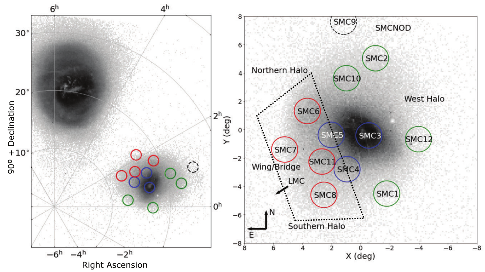

My research asks how the Magellanic Clouds, and dwarf galaxies more generally, were assembled. I work with large spectroscopic surveys (APOGEE and SDSS-V) and *Gaia* astrometry.

## The stellar populations of the Small Magellanic Cloud
*2023–present · first-author paper in SDSS-V collaboration review*

**Question.** Which stellar populations make up the SMC, and do the data require a separate outer component, such as tidal debris or a stellar halo?

**Data.** SDSS-V/BOSS spectra of SMC red giants from the Magellanic Genesis Survey, with line-of-sight velocities and MINESweeper metallicities, cross-matched to *Gaia* DR3 proper motions. I placed the metallicities on the APOGEE DR17 scale through stars observed by both surveys.

**Approach.** Along any line of sight, populations at different distances and with different origins overlap on the sky. I separate them by what each star carries: its line-of-sight velocity, proper motion, and metallicity. The model is an error-deconvolved Gaussian mixture (pyGMMis) that uses every star's measurement uncertainties and no stellar positions, so the sky distribution of each component is an independent check. Because a mixture model will always return components, the question is whether each one is required: I set the number of components with information criteria, bootstrap reproducibility, and mock catalogs of a single body, and measure a tip-of-the-red-giant-branch distance for each component.

**What it finds (preliminary; details when the paper is on arXiv).** A cold component lies in front of the SMC's main body and shares the inner body's metallicity, consistent with material pulled out of the inner SMC by the LMC. The most metal-poor component is also the hottest and the most extended: a halo candidate, whose origin, and whether it is a separate halo at all, are still open. A tidal component and a halo candidate thus coexist in one data set. Whether the main body is one population whose kinematics vary across it or more than one is not yet decided.

I presented this work in invited talks at STScI (2025, 2026) and the Flatiron Institute (2026). The GPU implementation of the model is public as [popmix-gpu](https://github.com/aalmeidat/popmix-gpu).

## Where did the SMC's near-side stars come from?
*2021–2024 · [Almeida et al. 2024, MNRAS, 529, 3858](https://doi.org/10.1093/mnras/stae373)*

**Question.** Stars in the SMC's eastern periphery fall into two groups at different distances. Were the nearer stars pulled out of the SMC by the LMC?

**Approach and result.** The SMC has radial metallicity gradients, so stars torn from its inner regions should carry the chemistry of its center rather than that of its outskirts. I combined APOGEE-2S abundances and radial velocities for 1,069 red giants in eleven fields with *Gaia* DR3 astrometry. The near-side population matches the chemistry of the SMC's center in eleven element-ratio spaces, supporting tidal extraction of inner-SMC stars during the LMC encounter. Relative distances came from a proper-motion proxy, which I compared with three published distance catalogs (astroNN, StarHorse, and NMSU).

*The APOGEE fields: East (red), Center (blue), and West (green), on the* Gaia *DR3 red-giant density. The dotted line outlines the region of the distance bimodality; the arrow points toward the LMC. Figure 1 of Almeida et al. 2024 ([CC BY 4.0](https://creativecommons.org/licenses/by/4.0/)).*

[MNRAS](https://doi.org/10.1093/mnras/stae373) · [arXiv:2308.13631](https://arxiv.org/abs/2308.13631)

## Binary stars in the Magellanic Clouds
*In progress*

I am looking into the binary fractions of the LMC and SMC.

## Earlier work: star clusters in early-type galaxies
*2012–2014*

HST/ACS mosaic imaging of extended star clusters in NGC 1023 ([Forbes, Almeida, et al. 2014, MNRAS, 442, 1049](https://ui.adsabs.harvard.edu/abs/2014MNRAS.442.1049F)), for which I did the mosaic, astrometry, photometry, and size measurements, and Magellan/IMACS photometry of the globular cluster system of NGC 2986.
